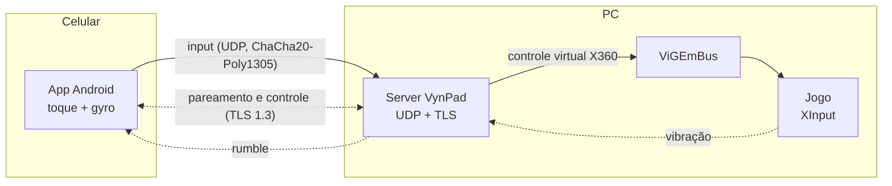

<div align="center">

# VynPad

**Transforme o celular Android em um controle de Xbox 360 para o PC.**

O jogo não sabe que existe um celular: ele enxerga um controle XInput de verdade.

[](https://github.com/esc4n0rx/VynPad/actions/workflows/ci.yml)


[Documentação](docs/README.md) · [Roadmap](docs/00-visao-geral/ROADMAP.md) · [Protocolo](docs/00-visao-geral/PROTOCOLO.md) · [Segurança](SECURITY.md)

</div>

---

## O que é

O VynPad tem duas partes que conversam pela rede local:

- **Server desktop** (Windows hoje, Linux depois): app de bandeja que cria até **4 controles Xbox 360 virtuais** com o driver ViGEmBus. Funciona em qualquer jogo, launcher ou emulador que aceite controle de Xbox: Steam, Game Pass, RetroArch e outros.
- **Client Android** (em desenvolvimento): o celular vira o controle, com botões, analógicos, gatilhos, vibração e giroscópio.



### Destaques

- **Latência baixa:** meta de p95 < 10 ms de ponta a ponta no Wi-Fi 5 GHz. Medido hoje, sem o celular: processamento no server em **0,04 ms** (p99) e **0,14 ms** do pacote UDP até o botão aparecer no `XInputGetState`.
- **Seguro por padrão:** pareamento por QR code ou PIN com *pinning* do certificado, TLS 1.3 no canal de controle, input UDP autenticado e cifrado, nada é processado de um aparelho não pareado. Veja o [modelo de ameaças](docs/SEGURANCA.md).
- **Descoberta automática** por mDNS, com broadcast como alternativa.
- **Mapeamento por controle:** remapeamento de botões, zonas mortas, curvas, gatilhos, turbo e gyro como analógico, com perfis que podem ser exportados e importados.
- **Vibração** do jogo repassada ao celular.
- **Monitor de latência** por controle: RTT, jitter e perda de pacotes.
- **Reconexão transparente:** o slot fica reservado por 30 s e, sem sinal, os botões são soltos em até 250 ms.
- **Interface moderna** com Mica/Acrylic, tema claro e escuro, bandeja do sistema, PT-BR e EN.

## Status

| Parte | Situação |
|---|---|
| Protocolo, rede, emulação, mapeamento, persistência | ✅ Pronto e testado |
| App desktop para Windows | 🟨 Funcional; instalador e atualização automática implementados, falta validar numa VM limpa e publicar o primeiro release |
| Linux (`uinput`) | ⬜ Planejado (F8) |
| App Android | ⬜ Planejado (F9) |

O quadro completo, task por task, está no [roadmap](docs/00-visao-geral/ROADMAP.md).

## Instalação (usuários)

1. Baixe o instalador da [última versão](https://github.com/esc4n0rx/VynPad/releases/latest) (`VynPad_x.y.z_x64-setup.exe`). A instalação é por usuário e não pede administrador.
2. Abra o VynPad: a introdução guia a instalação do [ViGEmBus](https://vigembusdriver.com/download/), a liberação no firewall e o primeiro pareamento.
3. O app se atualiza sozinho: ele avisa quando há versão nova e **nunca** instala com um controle conectado sem a sua confirmação.

Guias de uso: [primeiros passos](docs/usuario/pt-BR/primeiros-passos.md), [parear um celular](docs/usuario/pt-BR/parear-um-celular.md), [mapeamento e perfis](docs/usuario/pt-BR/mapeamento-e-perfis.md), [latência](docs/usuario/pt-BR/latencia.md) e [solução de problemas](docs/usuario/pt-BR/solucao-de-problemas.md).

## Estrutura do repositório

| Pasta | Conteúdo |
|---|---|
| `apps/desktop` | Server desktop: Tauri 2 + React + TypeScript + Tailwind |
| `apps/android` | Client Android: Kotlin + Jetpack Compose *(F9)* |
| `crates/vynpad-protocol` | Pacotes UDP, mensagens de controle, criptografia (`no_std` no núcleo) |
| `crates/vynpad-driver` | Controle virtual: ViGEmBus, XInput e `MockDriver` |
| `crates/vynpad-mapping` | Perfis, curvas, zonas mortas, gyro e turbo |
| `crates/vynpad-net` | UDP de input, servidor TLS de controle, descoberta, pareamento, firewall |
| `crates/vynpad-core` | Gerenciador dos 4 slots |
| `crates/vynpad-storage` | SQLite: dispositivos, perfis, configurações e histórico |
| `crates/vynpad-server` | Composição de tudo isso no `Core` usado pelo app |
| `crates/vynpad-sim` | Simulador CLI: faz o papel do celular para testar sem o Android |
| `protocol/` | Schemas, *test vectors* e implementação de referência, compartilhados entre Rust e Kotlin |
| `e2e/` | Testes de interface (WebdriverIO + `tauri-driver`) |
| `docs/` | Especificação, arquitetura, decisões, roadmap, tasks e guias do usuário |

## Desenvolvimento

Requisitos: Rust (versão fixada em `rust-toolchain.toml`), Node 22 ou mais novo, pnpm e, no Windows, o ViGEmBus para os testes de hardware.

```sh
pnpm install
pnpm --filter @vynpad/desktop tauri dev      # abre o app em modo de desenvolvimento
```

Sem o celular, o simulador faz o papel dele:

```sh
cargo run -p vynpad-sim -- pair --pin 123456 --host 127.0.0.1 --hold 60s   # o PIN aparece em Dispositivos > Parear novo
cargo run -p vynpad-sim -- bench --insecure-dev --clients 4 --rate 250     # com o dev_server rodando
```

### Qualidade

Os mesmos comandos do CI:

```sh
cargo fmt --all --check
cargo clippy --workspace --all-targets --locked -- -D warnings
cargo test --workspace --exclude vynpad-desktop --locked
cargo test -p vynpad-desktop --locked        # separado: ver a nota no ci.yml (CRT estática do Tauri)
cargo deny check
pnpm format:check && pnpm lint && pnpm typecheck && pnpm test
pnpm --filter @vynpad/protocol check         # test vectors em dia com o gerador
```

Testes de interface, cobertura e hardware:

```sh
pnpm --filter @vynpad/e2e e2e                                    # ver e2e/README.md
cargo llvm-cov --workspace --exclude vynpad-desktop              # mínimo de 80% nos crates de domínio
cargo test -p vynpad-server --release --test xinput_latency -- --ignored --nocapture --test-threads=1
```

A estratégia completa e o checklist manual de release estão em [`docs/QA-CHECKLIST.md`](docs/QA-CHECKLIST.md).

## Contribuindo e lançando versões

- Fluxo de trabalho, convenção de commits e como rodar tudo: [CONTRIBUTING.md](CONTRIBUTING.md).
- Uma tag `vX.Y.Z` igual à versão do `tauri.conf.json` dispara o [release](.github/workflows/release.yml): instalador NSIS e MSI assinados, `latest.json` do auto-update e notas geradas dos commits.
- Vulnerabilidades: veja [SECURITY.md](SECURITY.md). Não abra uma issue pública para elas.

## Licença

Software proprietário. Todos os direitos reservados; veja [LICENSE](LICENSE). Os componentes de terceiros estão em [docs/THIRD-PARTY-NOTICES.md](docs/THIRD-PARTY-NOTICES.md).
