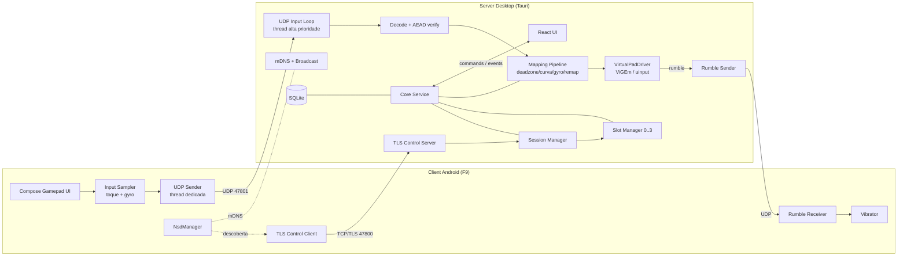

# Arquitetura

## 1. Visão geral



## 2. Estrutura do monorepo

```
PadGaming/
├─ apps/
│  ├─ desktop/                 # App Tauri
│  │  ├─ src/                  # React + TS (UI)
│  │  │  ├─ app/               # rotas, layout, providers
│  │  │  ├─ components/        # design system (ui/) + componentes de domínio
│  │  │  ├─ features/          # onboarding, dashboard, devices, mapping, settings, latency
│  │  │  ├─ i18n/              # pt-BR.json, en.json
│  │  │  ├─ lib/               # bindings tipados (tauri-specta), stores (zustand)
│  │  │  └─ assets/gamepad/    # SVGs do controle
│  │  └─ src-tauri/            # shell Tauri: commands, eventos, tray, janela
│  └─ android/                 # F9 — Kotlin + Compose
├─ crates/
│  ├─ padgaming-protocol/      # formatos de pacote, (de)serialização, AEAD
│  ├─ padgaming-driver/        # trait VirtualPadDriver + vigem (win) + uinput (linux)
│  ├─ padgaming-mapping/       # pipeline puro de mapeamento
│  ├─ padgaming-net/           # UDP loop, TLS control, descoberta
│  ├─ padgaming-storage/       # sqlx, migrations, repositórios
│  ├─ padgaming-core/          # orquestração: sessões, slots, métricas
│  └─ padgaming-sim/           # client simulador CLI
├─ protocol/
│  └─ test-vectors/            # JSON compartilhado Rust ↔ Kotlin
└─ docs/
```

Regra de dependência: `apps/desktop/src-tauri` → `core` → (`net`, `driver`, `mapping`, `storage`) → `protocol`. Nenhum crate de domínio depende de Tauri.

## 3. Threading e hot path

| Thread / Task | Tipo | Responsabilidade |
|---|---|---|
| `input-rx` | `std::thread`, prioridade alta, MMCSS "Games" (Windows) | `recv_from` bloqueante → decode → verify → mapping → `driver.update()` |
| `rumble-tx` | `std::thread` | Recebe rumble do driver (canal `crossbeam`) → envia UDP ao client |
| Runtime Tokio | async | TLS control, mDNS, persistência, emissão de eventos para a UI |
| `metrics` | intervalo Tokio | Agrega histogramas (`hdrhistogram`) e publica para a UI a 4 Hz |

Hot path: **sem alocação**, buffers pré-alocados, estado dos slots em arrays fixos (`[SlotState; 4]`), perfis compilados trocados via `ArcSwap` (sem lock na leitura).

## 4. Fluxo de conexão

```mermaid
sequenceDiagram
  participant A as Android
  participant S as Server
  A->>S: mDNS browse _padgaming._tcp
  A->>S: TLS connect :47800 (pin do fingerprint vindo do QR)
  A->>S: hello {device_id, name, proto_ver, pairing_token | device_token}
  S-->>A: welcome {session_id, udp_port, udp_key, slot, device_token?}
  loop até 250 Hz quando muda; 10 Hz ocioso
    A->>S: UDP InputState (AEAD)
  end
  S-->>A: UDP Rumble (quando muda + repete a cada 100 ms se ≠ 0)
  A->>S: UDP Ping
  S-->>A: UDP Pong (métricas RTT)
  Note over S: 250 ms sem pacotes → estado neutro<br/>TLS caiu → slot reservado por 30 s
```

## 5. Comunicação UI ↔ backend

- **Commands** (`#[tauri::command]`) tipados com `tauri-specta`, que gera `bindings.ts`.
- **Events** backend → UI: `slots:changed`, `devices:discovered`, `session:state`, `metrics:tick`, `input:live` (estado ao vivo, limitado a 60 Hz e emitido só enquanto uma tela o assina).
- Estado do frontend: `zustand` (UI e estado ao vivo) + `@tanstack/react-query` (dados persistidos via commands).

## 6. Diretórios de dados

| SO | Banco | Logs |
|---|---|---|
| Windows | `%APPDATA%\PadGaming\padgaming.db` | `%LOCALAPPDATA%\PadGaming\logs\` |
| Linux | `~/.local/share/padgaming/padgaming.db` | `~/.local/state/padgaming/logs/` |

Os caminhos são resolvidos via `app.path()` do Tauri.
