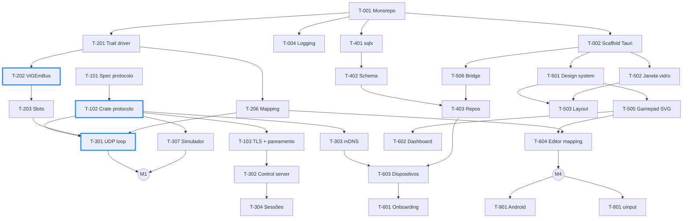

# Roadmap

> Estimativas: **P** ≤ 1 dia · **M** 2–3 dias · **G** 4–5 dias · **GG** > 1 semana (quebrar antes de iniciar).
> Prioridade: **P0** bloqueante · **P1** essencial para a v1 · **P2** desejável.

## 1. Marcos

```mermaid
gantt
  dateFormat  X
  axisFormat  %s
  section Windows
  M1 Primeiro input (sim → joy.cpl)      :m1, 0, 3
  M2 Server conectável e seguro          :m2, after m1, 3
  M3 App com cara de produto             :m3, after m2, 3
  M4 Windows v1.0                        :m4, after m3, 4
  section Linux
  M5 Linux v1.0                          :m5, after m4, 2
  section Android
  M6 Android MVP → PadGaming 1.0         :m6, after m5, 4
```

*(Unidades relativas em sprints de ~1 semana; não são datas.)*

| Marco | Resultado verificável | Tasks |
|---|---|---|
| **M1 — Primeiro input** | O `padgaming-sim` move um controle X360 virtual que aparece no `joy.cpl` e funciona num jogo | T-001, T-004, T-101, T-102, T-201, T-202, T-203, T-206, T-301, T-307 |
| **M2 — Server conectável e seguro** | Descoberta via mDNS, pareamento por QR/PIN, TLS, reconexão; dados no SQLite | T-002, T-103, T-302, T-303, T-304, T-306, T-401, T-402, T-403, T-506 |
| **M3 — App com cara de produto** | Janela com vidro, onboarding, dashboard ao vivo, tela de dispositivos | T-003, T-205, T-501–T-505, T-601, T-602, T-603 |
| **M4 — Windows v1.0** | Mapeamento, rumble, latência, tray, instalador assinado, auto-update | T-204, T-305, T-604–T-608, T-701–T-706 |
| **M5 — Linux v1.0** | Mesmo app no Linux com uinput, AppImage/deb/rpm | T-801–T-804 |
| **M6 — Android → PadGaming 1.0** | App Android completo publicado; ecossistema ponta a ponta | T-901–T-910 |

## 2. Grafo de dependências (caminho crítico em destaque)

## 3. Quadro de tasks

### F0 — Fundação
| ID | Task | Prio | Est. | Depende de | Status |
|---|---|---|---|---|---|
| [T-001](../tasks/F0-fundacao/T-001-monorepo-workspace.md) | Monorepo e workspace Cargo | P0 | P | — | ✅ |
| [T-002](../tasks/F0-fundacao/T-002-scaffold-tauri-react.md) | Scaffold Tauri 2 + React/TS/Vite/Tailwind | P0 | M | T-001 | ✅ |
| [T-003](../tasks/F0-fundacao/T-003-qualidade-ci.md) | Lint, format, hooks e CI | P1 | M | T-002 | ✅ |
| [T-004](../tasks/F0-fundacao/T-004-logging-erros.md) | Logging, erros e diagnóstico | P0 | P | T-001 | ✅ |

### F1 — Protocolo
| ID | Task | Prio | Est. | Depende de | Status |
|---|---|---|---|---|---|
| [T-101](../tasks/F1-protocolo/T-101-spec-protocolo.md) | Especificação final do protocolo v1 + test vectors | P0 | M | — | ✅ |
| [T-102](../tasks/F1-protocolo/T-102-crate-protocolo.md) | Crate `padgaming-protocol` | P0 | M | T-001, T-101 | ✅ |
| [T-103](../tasks/F1-protocolo/T-103-tls-pareamento.md) | TLS, certificado e pareamento QR/PIN | P0 | G | T-102 | ✅ |

### F2 — Emulação Windows
| ID | Task | Prio | Est. | Depende de | Status |
|---|---|---|---|---|---|
| [T-201](../tasks/F2-emulacao-windows/T-201-trait-driver.md) | Trait `VirtualPadDriver` + driver mock | P0 | P | T-001 | ✅ |
| [T-202](../tasks/F2-emulacao-windows/T-202-backend-vigem.md) | Backend ViGEmBus | P0 | M | T-201 | ✅ |
| [T-203](../tasks/F2-emulacao-windows/T-203-slot-manager.md) | Slot Manager (4 controles) | P0 | M | T-202 | ✅ |
| [T-204](../tasks/F2-emulacao-windows/T-204-rumble-server.md) | Rumble: driver → client | P1 | M | T-202, T-301 | 🟨 |
| [T-205](../tasks/F2-emulacao-windows/T-205-deteccao-vigem-xinput.md) | Detecção/instalação do ViGEmBus e slots XInput | P0 | M | T-202 | 🟨 |
| [T-206](../tasks/F2-emulacao-windows/T-206-pipeline-mapeamento.md) | Pipeline de mapeamento + gyro | P0 | G | T-201 | 🟨 |

### F3 — Rede
| ID | Task | Prio | Est. | Depende de | Status |
|---|---|---|---|---|---|
| [T-301](../tasks/F3-rede/T-301-udp-input-loop.md) | Loop UDP de input (hot path) | P0 | G | T-102, T-203, T-206 | ✅ |
| [T-302](../tasks/F3-rede/T-302-control-server-tls.md) | Servidor de controle TLS | P0 | G | T-103, T-203 | ✅ |
| [T-303](../tasks/F3-rede/T-303-descoberta-mdns.md) | Descoberta mDNS + broadcast | P0 | M | T-102 | 🟨 |
| [T-304](../tasks/F3-rede/T-304-ciclo-vida-sessao.md) | Ciclo de vida da sessão e reconexão | P0 | M | T-301, T-302 | 🟨 |
| [T-305](../tasks/F3-rede/T-305-metricas-latencia.md) | Métricas de latência | P1 | M | T-301 | 🟨 |
| [T-306](../tasks/F3-rede/T-306-firewall-windows.md) | Regras de firewall do Windows | P0 | P | T-301 | 🟨 |
| [T-307](../tasks/F3-rede/T-307-simulador-cli.md) | Simulador CLI `padgaming-sim` | P0 | M | T-102 | 🟨 |

### F4 — Persistência
| ID | Task | Prio | Est. | Depende de | Status |
|---|---|---|---|---|---|
| [T-401](../tasks/F4-persistencia/T-401-setup-sqlx.md) | Setup SQLite + sqlx + migrations | P0 | P | T-001 | 🟨 |
| [T-402](../tasks/F4-persistencia/T-402-schema-v1.md) | Schema v1 | P0 | M | T-401 | ✅ |
| [T-403](../tasks/F4-persistencia/T-403-repositorios-commands.md) | Repositórios, serviços e commands | P0 | M | T-402, T-506 | ✅ |

### F5 — UI Shell
| ID | Task | Prio | Est. | Depende de | Status |
|---|---|---|---|---|---|
| [T-501](../tasks/F5-ui-shell/T-501-design-system.md) | Design system: tokens + componentes base | P0 | G | T-002 | 🟨 |
| [T-502](../tasks/F5-ui-shell/T-502-janela-vibrancy.md) | Janela custom: vidro, cantos, semáforo | P0 | M | T-002 | 🟨 |
| [T-503](../tasks/F5-ui-shell/T-503-layout-navegacao.md) | Layout, sidebar, rotas e transições | P0 | M | T-501, T-502 | 🟨 |
| [T-504](../tasks/F5-ui-shell/T-504-i18n.md) | i18n PT-BR / EN | P1 | P | T-503 | 🟨 |
| [T-505](../tasks/F5-ui-shell/T-505-gamepad-svg-icones.md) | Gamepad SVG ao vivo + ícones | P0 | G | T-501 | 🟨 |
| [T-506](../tasks/F5-ui-shell/T-506-bridge-tipada.md) | Bridge tipada Tauri ↔ React | P0 | M | T-002 | 🟨 |

### F6 — Features
| ID | Task | Prio | Est. | Depende de | Status |
|---|---|---|---|---|---|
| [T-601](../tasks/F6-features/T-601-onboarding.md) | Onboarding | P0 | G | T-205, T-306, T-603 | 🟨 |
| [T-602](../tasks/F6-features/T-602-dashboard.md) | Dashboard dos 4 slots | P0 | M | T-203, T-505, T-506 | 🟨 |
| [T-603](../tasks/F6-features/T-603-dispositivos-pareamento.md) | Dispositivos: próximos, pareados, parear | P0 | G | T-103, T-303, T-403 | 🟨 |
| [T-604](../tasks/F6-features/T-604-editor-mapeamento.md) | Editor de mapeamento e perfis | P0 | G | T-206, T-403, T-505 | 🟨 |
| [T-605](../tasks/F6-features/T-605-configuracoes.md) | Configurações | P1 | M | T-403, T-504 | 🟨 |
| [T-606](../tasks/F6-features/T-606-monitor-latencia.md) | Monitor de latência | P1 | M | T-305, T-503 | 🟨 |
| [T-607](../tasks/F6-features/T-607-tray-autostart.md) | Tray, autostart, iniciar minimizado | P1 | M | T-503 | 🟨 |
| [T-608](../tasks/F6-features/T-608-notificacoes.md) | Notificações e toasts | P2 | P | T-602 | 🟨 |

### F7 — Qualidade e release Windows
| ID | Task | Prio | Est. | Depende de | Status |
|---|---|---|---|---|---|
| [T-701](../tasks/F7-release-windows/T-701-testes.md) | Estratégia e suíte de testes | P0 | G | T-307 | ⬜ |
| [T-702](../tasks/F7-release-windows/T-702-benchmark-latencia.md) | Benchmark de latência e performance | P0 | M | T-305, T-307 | ⬜ |
| [T-703](../tasks/F7-release-windows/T-703-instalador-windows.md) | Instalador NSIS + ViGEmBus + assinatura | P0 | M | T-205, T-306 | ⬜ |
| [T-704](../tasks/F7-release-windows/T-704-auto-update.md) | Auto-update | P1 | M | T-703 | ⬜ |
| [T-705](../tasks/F7-release-windows/T-705-docs-diagnostico.md) | Docs do usuário e pacote de diagnóstico | P1 | M | T-004 | 🟨 |
| [T-706](../tasks/F7-release-windows/T-706-revisao-seguranca.md) | Revisão de segurança | P1 | M | T-103, T-302 | ✅ |

### F8 — Linux
| ID | Task | Prio | Est. | Depende de | Status |
|---|---|---|---|---|---|
| [T-801](../tasks/F8-linux/T-801-backend-uinput.md) | Backend `uinput` (X360) | P0 | G | T-201 | ⬜ |
| [T-802](../tasks/F8-linux/T-802-permissoes-udev.md) | Permissões udev + onboarding Linux | P0 | M | T-801, T-601 | ⬜ |
| [T-803](../tasks/F8-linux/T-803-ui-linux.md) | Adaptações de UI no Linux | P1 | M | T-502, T-607 | ⬜ |
| [T-804](../tasks/F8-linux/T-804-empacotamento-linux.md) | Empacotamento AppImage/deb/rpm | P0 | M | T-801 | ⬜ |

### F9 — Client Android (por último)
| ID | Task | Prio | Est. | Depende de | Status |
|---|---|---|---|---|---|
| [T-901](../tasks/F9-android/T-901-scaffold-android.md) | Scaffold Kotlin + Compose | P0 | M | — | ⬜ |
| [T-902](../tasks/F9-android/T-902-protocolo-kotlin.md) | Protocolo em Kotlin + test vectors | P0 | M | T-101, T-901 | ⬜ |
| [T-903](../tasks/F9-android/T-903-descoberta-android.md) | Descoberta NSD + broadcast + IP manual | P0 | M | T-902 | ⬜ |
| [T-904](../tasks/F9-android/T-904-pareamento-android.md) | Pareamento QR/PIN + TLS pinning | P0 | G | T-903 | ⬜ |
| [T-905](../tasks/F9-android/T-905-layout-gamepad.md) | Layout do gamepad (multitouch) | P0 | G | T-901 | ⬜ |
| [T-906](../tasks/F9-android/T-906-motor-envio.md) | Motor de envio de baixa latência | P0 | M | T-902, T-905 | ⬜ |
| [T-907](../tasks/F9-android/T-907-rumble-android.md) | Rumble → vibração | P1 | P | T-906 | ⬜ |
| [T-908](../tasks/F9-android/T-908-gyro.md) | Gyro / acelerômetro | P1 | M | T-906 | ⬜ |
| [T-909](../tasks/F9-android/T-909-personalizacao.md) | Personalização de layout e configurações | P2 | G | T-905 | ⬜ |
| [T-910](../tasks/F9-android/T-910-release-android.md) | QA e release na Play Store | P1 | M | T-904–T-908 | ⬜ |

## 4. Definition of Done (vale para toda task)

- [ ] Critérios de aceite da task atendidos.
- [ ] `cargo clippy -- -D warnings`, `cargo fmt --check`, `pnpm lint` e `pnpm typecheck` passando.
- [ ] Testes novos ou atualizados; CI verde.
- [ ] Textos da UI nos arquivos de i18n (PT-BR e EN).
- [ ] Docs atualizados (PROTOCOLO, ARQUITETURA ou DECISOES) quando houver impacto.
- [ ] Status atualizado neste quadro.
